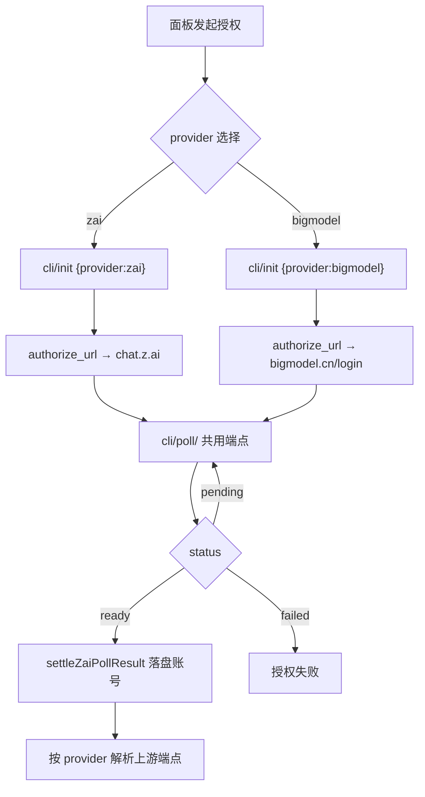
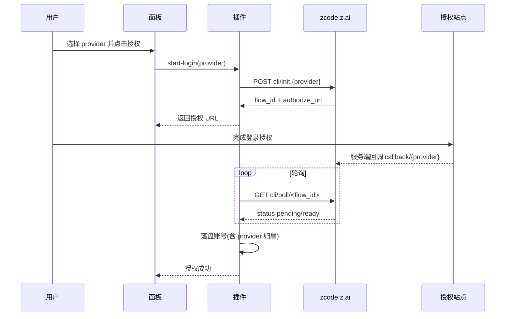

# zcode-provider 支持 bigmodel（中国区）OAuth 授权需求

- 编号：REQ-ZCODE-BIGMODEL-OAUTH-20261014
- 提出时间：2026-10-14（用户）
- 状态：草稿（待用户确认 provider 策略细节后转已确认）
- 版本：v0.1

结论：让 `zcode-provider` 在现有 `zai`（国际站）授权之外，新增 `bigmodel`（中国区）OAuth 授权能力，使授权得到的账号归属中国区、可获取中国区的每日额度政策；影响：所有通过 CPA 使用 ZCode 的用户，尤其是需要中国区每日额度的账号；范围：`zcode` 插件的 OAuth 授权链路、上游端点解析、额度查询链路、面板授权入口与账号标识；非范围：不改 `zai` 国际站既有行为、不改宿主、不改其它 7 个插件；变化：面板可分别发起 `zai` 与 `bigmodel` 两种授权，账号卡片可区分归属；完成标准：能用 `bigmodel` 完成授权登录、拿到可调用凭据、查询到中国区额度；术语说明：`provider` 指 ZCode 服务端 CLI OAuth 初始化接口的 `provider` 参数（取值 `zai` / `bigmodel`），决定签发哪个站点的授权地址；验证状态：已完成静态代码审计与线上只读端点实测（未改动任何代码或生产配置）。

## 1. 背景与动因

- 现状：`zcode/oauth.go:330` 硬编码 `zaiCLIInit("zai")`，授权链路固定走国际站。实测其签发的 `authorize_url` 指向 `https://chat.z.ai/api/oauth/authorize?...`（国际站授权页）。
- 问题：国际站账号没有中国区每日额度赠送；用户需要中国区（`bigmodel`）账号的额度政策。
- 动因：`provider` 参数本就在 ZCode 服务端接口上支持切换（实测确认），插件侧却写死为 `zai`，属于能力未开放而非能力缺失。

## 2. 关键实测证据（2026-10-14 线上只读探测）

### 2.1 `provider` 参数实测对照

| provider 取值 | 结果 | 签发的 authorize_url |
| --- | --- | --- |
| `zai` | ✅ `code:0` | `https://chat.z.ai/api/oauth/authorize?client_id=client_P8X5CMWmlaRO9gyO-KSqtg&redirect_uri=https://zcode.z.ai/api/v1/oauth/cli/callback/zai&...` |
| `bigmodel` | ✅ `code:0` | `https://bigmodel.cn/login?appId=zcode&redirect=https://zcode.z.ai/api/v1/oauth/cli/callback/bigmodel&state=...` |
| `zai-cn` / `cn` / `zhipu` / `zai_cn` / `bigmodel-cn` | ❌ `code:1000 something went wrong` | — |

结论：**`provider` 只有 `zai` 与 `bigmodel` 两个有效值**，其余全部报错。

### 2.2 bigmodel 复用现有 CLI 轮询链路（关键结论）

| 环节 | bigmodel 实测 | 与 zai 关系 |
| --- | --- | --- |
| CLI init | `POST https://zcode.z.ai/api/v1/oauth/cli/init` body `{"provider":"bigmodel"}` → **200** | **共用同一端点** |
| CLI poll | `GET https://zcode.z.ai/api/v1/oauth/cli/poll/<flow_id>` → **200 `{"status":"pending"}`** | **共用同一端点** |
| authorize 回调 | `https://zcode.z.ai/api/v1/oauth/cli/callback/bigmodel`（服务端注册） | 回调路径不同（`/bigmodel` vs `/zai`） |
| 授权页 | `https://bigmodel.cn/login?appId=zcode` | 域名不同，**用 `appId=zcode`，不需要 client_id** |

⇒ **不需要重新实现授权流程**。CLI 轮询骨架、poll 端点、会话状态机全部可复用，差异集中在 `provider` 参数、authorize 域名、回调路径与 appId。

### 2.3 端点存活探测（证明链路可用）

| 端点 | 探测结果 |
| --- | --- |
| `POST https://bigmodel.cn/api/auth/z/login` | 200 + JWT 解析错误（端点存活，参数格式待验证） |
| `POST https://open.bigmodel.cn/api/auth/z/login` | 200 + JWT 解析错误（同上） |
| `POST https://open.bigmodel.cn/api/anthropic/v1/messages` | 401 `令牌已过期或验证不正确`（端点存活） |
| `POST https://bigmodel.cn/api/anthropic/v1/messages` | 401（端点存活） |
| `GET https://zchat.z.ai/api/oauth/authorize` | 307 → `/auth`（存在，但**非本需求目标**） |

### 2.4 客户端 asar 静态证据（ZCode 3.15.1，`D:/zcode/resources/app.asar`）

- provider 家族定义：`{id:"zai",...oauthProviderId:"zai",startPlanProviderId:"account:zai-start-plan"}` 与 `{id:"bigmodel",...rootDomain:"bigmodel.cn",startPlanProviderId:"account:bigmodel-start-plan"}`
- 推理端点常量：`open.bigmodel.cn/api/anthropic`（bigmodel）与 `api.z.ai/api/anthropic`（zai）
- 凭据类型枚举：`accountType: ["zai","bigmodel"]`、`family: ["zai","bigmodel"]`
- **注意**：asar 中 `zchat.z.ai` 零命中，说明该域名属于 3.15.1 之后新增，不作为本需求依据。

## 3. 现状代码事实（只读审计）

| 文件 | 现状 | 影响 |
| --- | --- | --- |
| `zcode/oauth.go:330` | `zaiCLIInit("zai")` 硬编码 | 需参数化 |
| `zcode/oauth.go:114` | `zaiCLIInit(provider string)` 已接受参数 | 骨架已具备 |
| `zcode/oauth.go:229-232` | `settleZaiPollResult` 已兼容 `Zai` / `Bigmodel` 双字段 | 无需改 |
| `zcode/oauth.go:36` | `zaiOAuthAuthorizeURL` 死常量，全仓零引用 | 可直接清理 |
| `zcode/upstream_target.go` | 两条链路：`zaiCodingPlanBaseURL` / `zaiAPIAuthropicBaseURL` | 需加 bigmodel 分支 |
| `zcode/business_token.go:31` | `zaiBusinessLoginEndpoint = "https://api.z.ai/api/auth/z/login"` 单一端点 | 需按 provider 分支 |
| `zcode/quota.go:22-23` | 额度/领取端点固定 `zcode.z.ai` | 需确认 bigmodel 是否共用 |
| `zcode/authfile.go:29-49` | `StoredAuth` 无 provider 归属字段 | 需新增字段区分 zai/bigmodel |
| `zcode/panel.html:233` | 单一「OAuth 授权登录」按钮 | 需支持 provider 选择 |

## 4. 范围与非范围

### 4.1 In Scope

- OAuth 授权链路 provider 参数化（`zai` / `bigmodel` 双支持）。
- 上游端点解析按 provider 分支（推理 base、业务令牌端点）。
- 额度查询链路按 provider 适配（待 2.1 结论确认）。
- 面板授权入口支持 provider 选择，账号卡片展示归属。
- 账号凭据结构新增 provider 归属字段（向后兼容：缺省视为 `zai`）。

### 4.2 Out of Scope

- 不改 `zai` 国际站既有行为与端点。
- 不实现 `zchat.z.ai` 链路（实测非目标，且客户端无此域名）。
- 不改宿主 CPA、不改其它插件。
- 不做 `bigmodel` 的 team-coding-plan / individual-coding-plan 高级形态。

## 5. 关键缺口（gap-routing）

### 5.1 已用静态证据消解的缺口

| ID | 原缺口 | 消解结论 | 证据 |
| --- | --- | --- | --- |
| GAP-002 | `bigmodel` 额度查询端点是否与 zai 共用 | **不共用，按 family 分支**：bigmodel 走 `bigmodel.cn/api/biz/subscription/list`，zai 走 `zcode.z.ai` 同路径 | 实测：`bigmodel.cn/api/biz/subscription/list` → 401 鉴权拒绝（端点存在）；`zcode.z.ai/api/biz/subscription/list` → **404**。asar：zai 用 `buildZaiSubscriptionListUrl()`，bigmodel 用另一构造函数 |
| GAP-003 | `bigmodel` 业务令牌是否同样需要 `api/auth/z/login` | **链路不同**：bigmodel 走 `resolveBigModelStartPlanZcodeJwt`（从 credentialService 载入 JWT），与 zai 的 `apiKey` 分支分离 | asar：`Sye(e,t)` 内 `if(e.family==="bigmodel")` 走 `UK()` 解析，zai 走 `Cye()` + apiKey |
| GAP-001 | token 交换端点与凭据形态是否一致 | **大幅降级为低风险**：poll 端点共用且响应结构含 `bigmodel` 字段 | 实测：`cli/poll/<flow_id>` 对 bigmodel flow 返回 200；`oauth.go:229-232` 已兼容 `Zai`/`Bigmodel` 双字段 |

### 5.2 新增发现

- **端点 origin 按 family 重写**：asar 存在 `rewriteZCodeEndpointUrl`，当 URL origin 等于 `zcode.z.ai` 且配置 origin 不同时，会重写 pathname/search/hash。说明插件侧端点也应按 family 决定 origin。
- **推理端点按 family 分支**：`open.bigmodel.cn/api/anthropic`（bigmodel）vs `api.z.ai/api/anthropic`（zai），实测两者均存活（401 为预期）。

### 5.3 仍阻断的缺口（需真实 bigmodel 账号）

| ID | 缺口 | 影响 | 状态 |
| --- | --- | --- | --- |
| GAP-004 | 中国区账号授权后是否自带 start-plan 每日额度（还是仍需客户端 claim） | 决定改造业务价值 | **已解除（2026-10-14 真实账号实测）**：`plan_status=active`、`total_grant=8000000`（GLM-5.3 300万 + GLM-5.3-Flash 500万），**无需客户端 claim**，业务价值成立 |
| GAP-005 | `bigmodel` 的模型清单与 `zai` 是否一致 | 决定 models.go 是否需改 | **已解除（2026-10-14 真实账号实测）**：与 zai **完全一致**（5 模型全同），`models.go` 无需 family 分支 |
| GAP-006 | bigmodel 推理鉴权失败：JWT → 401「令牌已过期或验证不正确」，`access_token` → 500「Internal Network Failure」；业务令牌换取端点报「z.ai用户信息异常」 | 授权/额度/模型清单可用但**无法推理**，AC-002 未达成 | **已解除（2026-10-14，0.1.27）**：根因为推理端点误用 `open.bigmodel.cn`（不接受 ZCode JWT）；改为与国际站共用 `zcode.z.ai/api/v1/zcode-plan/anthropic` 后，bigmodel 探活由 401 → 429/3009 或 405/3012（鉴权通过），与 zai 账号行为完全一致 |

> 说明：GAP-004 / GAP-005 已由 CYCLE-3 真实账号端到端验证解除（证据见 `doc/5-tests/2026-10-14_214500_zcode_bigmodel中国区授权CYCLE3真实账号端到端测试.md`）。**GAP-006 为 CYCLE-3 新发现**：`bigmodel` 授权链路（复用 zai CLI 轮询）已验证可用，但推理链路不复用——JWT 被拒（401）、`access_token` 触达鉴权层后上游内部失败（500），且 zai 的业务令牌换取端点对 bigmodel 账号报「z.ai用户信息异常」，说明 CYCLE-1 的「bigmodel 复用 zai 业务令牌链路」假设在推理侧不成立。

## 6. 待确认决策（P1）

| ID | 决策点 | 已定结论 | 授权来源 |
| --- | --- | --- | --- |
| DEC-001 | provider 策略 | **双 provider 共存**（面板可选 `zai` / `bigmodel`），现有国际站账号不受影响 | 2026-10-14 用户 AskUserQuestion 确认 |
| DEC-002 | 是否复用 CLI 轮询链路 | 复用（实测 bigmodel 共用 init/poll 端点） | 2026-10-14 实测 |
| DEC-003 | GAP-001~005 的验证方式与责任账号 | **未定** | 待用户提供 bigmodel 测试账号 |

## 7. 验收标准（AC-*）

| ID | 验收条件 | 验证入口 |
| --- | --- | --- |
| AC-001 | 面板可选 `bigmodel` 发起授权，跳转至 `bigmodel.cn/login` | 面板手动操作 + 断言授权 URL 域名 |
| AC-002 | `bigmodel` 授权完成后账号落盘，凭据可调用上游 | 真实账号端到端 |
| AC-003 | `zai` 既有授权行为零回归 | 既有单测 + 面板回归脚本 |
| AC-004 | 账号卡片可区分 `zai` / `bigmodel` 归属 | 面板静态断言 |
| AC-005 | `cgo-shim-build.py zcode` build/vet/test 全绿 | 本地构建 |

## 8. 图形化需求表达

授权链路分流（Mermaid flowchart）：

授权时序（Mermaid sequenceDiagram）：

图片资产决策：`N/A + 原因 + 证据`——本需求无 UI 设计稿与外部图片素材，全部信息由实测表格与 Mermaid 图表达。

## 9. 验证策略与阻断项

- 验证策略：静态审计（已完成）→ 真实账号端到端（GAP-001~005）→ 本地 `cgo-shim-build.py` → 面板回归脚本。
- 阻断项：**GAP-001~005 缺真实 bigmodel 账号无法验证**，是当前唯一 P0 阻断，未解除前不得进入编码。

## 10. 参考资料

- 知识库：`D:/谷歌云盘/知识库/20-Knowledge/项目/CLIProxyAPI/Z.ai-ZCode-OAuth授权契约-CLI轮询模式.md`
- 代码：`zcode/oauth.go`、`zcode/upstream_target.go`、`zcode/business_token.go`、`zcode/quota.go`、`zcode/authfile.go`
- 客户端：`D:/zcode/resources/app.asar`（ZCode 3.15.1）
- 相关 Bug：`doc/4-bugs/2026-10-14_124500_glm-5.3收敛zcode独家承接待并发限流致推理503根因诊断.md`
