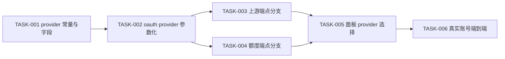

# 需求实施总览：zcode-provider 支持 bigmodel（中国区）OAuth 授权

结论：在 `zcode` 插件中把 OAuth 授权链路的 `provider` 参数化（`zai` / `bigmodel` 双支持），并让上游端点按 provider 分支，使面板可分别发起国际站与中国区授权；影响：所有通过 CPA 使用 ZCode 的用户，尤其是需要中国区每日额度的账号；范围：`zcode/oauth.go`、`upstream_target.go`、`business_token.go`、`quota.go`、`authfile.go`、`panel.html` 与对应测试；非范围：不改 `zai` 既有行为、不实现 `zchat.z.ai` 链路、不改宿主与其它插件；变化：面板新增 provider 选择，账号卡片可区分归属，中国区账号可完成授权并走中国区端点；完成标准：`bigmodel` 授权端到端可用且 `zai` 零回归，`cgo-shim-build.py zcode` 全绿；术语说明：`provider` 指 ZCode 服务端 `cli/init` 的 provider 参数，决定签发哪个站点的授权地址；验证状态：需求文档已落盘，静态证据已收集，真实账号端到端验证待 GAP-004/005 解除。

## 1. 当前计划最终方案简要说明

- 推荐方案一句话结论：**provider 参数化 + 端点按 family 分支**，复用现有 CLI 轮询骨架，不重新实现授权流程。
- 主落点 / 主路径：`zcode/oauth.go`（provider 参数注入）→ `zcode/upstream_target.go`（端点分支）→ `zcode/authfile.go`（归属字段）→ `zcode/panel.html`（provider 选择）。
- 为什么先走这条路线：实测确认 bigmodel 与 zai **共用** `cli/init` 与 `cli/poll` 端点（仅 `provider` 参数与回调路径不同），复用成本远低于重写；且用户已确认「双 provider 共存」。

## 2. 基本信息

- 对应需求文档：`doc/2-需求/2026-10-14_153951_zcode支持bigmodel中国区授权需求.md`
- 来源对象标识：`REQ-ZCODE-BIGMODEL-OAUTH-20261014`
- 当前实施文档命名主干：`2026-10-14_zcode支持bigmodel中国区授权实施总览`
- 实施计划完成条件（`AC-*`）所在章节：第 6 章
- 对应 `6-review` 风格回归记录：待实施完成后生成 `doc/6-review/`
- agent 理解的问题 / 目标：插件把 `provider` 写死为 `zai`，导致只能签国际站账号；需开放 `bigmodel` 以获取中国区额度政策。
- 当前计划范围：provider 参数化、端点分支、凭据归属字段、面板选择、测试。
- 明确不在范围：`zai` 行为变更、`zchat.z.ai` 链路、team/individual coding-plan 高级形态、宿主改动。
- 当前优先闭环：CYCLE-1（provider 参数化骨架，纯逻辑可单测，不依赖真实账号）。
- 关键假设 / 待确认点：见第 2.2 节。
- 跨会话执行入口：本文件第 1、2、7 章。
- 主项目地址、仓库类型与代码基线：`D:\luode\cpa-workbuddy-plugin`，Go c-shared 插件仓库，基线 `zcode-provider 0.1.24`。
- local 环境与依赖入口：本地 `python scripts/cgo-shim-build.py zcode`（无 CGO 环境下的 build/vet/test）。
- 外部项目代码引用：`N/A + 原因 + 证据`——仅读取本机 `D:/zcode/resources/app.asar` 作为只读逆向参考，不复制其代码，无外部仓库依赖。
- 当前状态：草稿（CYCLE-1 可立即实施；CYCLE-2 需真实账号）
- 是否已获得开始实施授权：**未获得**（用户已确认 provider 策略方向，但尚未下达「开始实施」指令）
- 若当前为受限计划 / 阻断计划：本计划**不得作为实施授权**，需用户明确开工指令后进入编码。

## 2.1 决策维度覆盖表

| 维度 | 状态 | 结论 / 依据 |
| --- | --- | --- |
| 架构 / 技术路线 | 已确定 | 复用 CLI 轮询 + provider 参数化（实测 bigmodel 共用 init/poll） |
| 代码落点（目录 / 包 / 文件） | 已确定 | `zcode/` 目录内 6 文件，见第 3 章目录树 |
| 实现方式 | 已确定 | 常量表 + 按 provider 查表分支，不引入接口抽象 |
| 命名 | 已确定 | `providerZai` / `providerBigmodel` 常量；`sa.ProviderFamily` 字段 |
| 注释 | 已确定 | 遵循 `comment-rules`：函数头 `[参数]/[返回]/最近修改时间`，步骤编号 |
| 日志 | 已确定 | 复用现有 `logf` 风格，中文表达 |
| 错误处理 / 异常 | 已确定 | 未知 provider 返回明确错误，不静默回退 `zai` |
| 数据模型 / 表 / 字段 | 已确定 | `StoredAuth` 新增 `ProviderFamily string`（json: `provider_family,omitempty`），缺省视为 `zai` |
| 接口契约 | 已确定 | 沿用宿主 `AuthLoginStartRequest`，provider 经现有 request 载荷传递 |
| 依赖与库 | N/A | 无新增依赖 |
| 测试策略 / 样本 | 已确定 | mock 注入点已存在（`mockOAuthCLIInitURL` / `mockZaiBusinessLoginURL`），见第 7 章 |
| 真实账号端到端 | **未决待选** | GAP-004/005 需用户提供 bigmodel 账号 |

## 2.2 待用户选择清单

- 未决决策点 1：**bigmodel 真实测试账号**
  - 待选选项（推荐项置首）：
    1. 用户提供 bigmodel 账号，本轮一并完成端到端验证（推荐）；
    2. 先只做 CYCLE-1（provider 参数化骨架 + 单测），端到端验证另开一轮；
    3. 暂不实施，先仅保留需求与计划文档。
  - 挂起的下游内容：CYCLE-2 及以后全部内容、`AC-002`/`AC-004` 的验证。

- 未决决策点 2：**panel.html 的 provider 选择交互形态**
  - 待选选项（推荐项置首）：
    1. 授权按钮旁加下拉选择（`zai` / `bigmodel`），默认 `zai`（推荐，改动最小）；
    2. 拆成两个独立按钮（「OAuth 授权登录（国际站）」/「OAuth 授权登录（中国区）」）；
    3. 弹窗内选择 provider。
  - 挂起的下游内容：CYCLE-3 的 UI 落点。

## 2.3 跨会话独立执行与外部项目代码引用清单

- 新会话接手第一步：读取本文件第 1、2 章 + 需求文档 `doc/2-需求/2026-10-14_153951_zcode支持bigmodel中国区授权需求.md`。
- 外部项目代码引用：`N/A + 原因 + 证据`——只读逆向 `D:/zcode/resources/app.asar`（ZCode 3.15.1 客户端），不复制其代码。

## 3. 现状与落点

### 3.1 代码落点目录树

```text
zcode/
├── oauth.go            # [改] provider 参数化：zaiCLIInit(provider) 调用点 + authorize 常量表
├── upstream_target.go  # [改] resolveUpstreamTargets 按 family 分支
├── business_token.go   # [改] 业务令牌端点按 family 分支
├── quota.go            # [改] 额度端点按 family 分支（zai: zcode.z.ai；bigmodel: bigmodel.cn/api/biz/subscription/list）
├── authfile.go         # [改] StoredAuth 新增 ProviderFamily 字段
├── main.go             # [改] Config 新增字段（如需要）+ 版本 bump
├── panel.html          # [改] provider 选择交互 + 卡片归属标识
├── oauth_test.go       # [新] provider 参数化单测
├── upstream_target_test.go # [新] 端点分支单测
└── (现有 *_test.go)    # [改] 补齐 provider 分支用例
```

### 3.2 关键现状

| 位置 | 现状 | 目标 |
| --- | --- | --- |
| `oauth.go:330` | `zaiCLIInit("zai")` | 由请求载荷/配置决定 provider |
| `oauth.go:36` | `zaiOAuthAuthorizeURL` 死常量 | 删除或改为 provider 表 |
| `oauth.go:229-232` | 已兼容 `Zai`/`Bigmodel` 双字段 | 保持 |
| `upstream_target.go:12-15` | 两个固定 base | 增 bigmodel 分支 |
| `business_token.go:31` | 单一 `api.z.ai` 端点 | 按 family 分支 |
| `quota.go:22-23` | 固定 `zcode.z.ai` | 按 family 分支 |
| `authfile.go:29-49` | 无归属字段 | 新增 `ProviderFamily` |

## 4. 依赖图与垂直切片



- 垂直切片：CYCLE-1（TASK-001~004，纯逻辑，可单测）；CYCLE-2（TASK-005，UI）；CYCLE-3（TASK-006，真实账号验证）。

## 5. 实施周期与最小任务

### CYCLE-1：provider 参数化骨架（可立即实施，不依赖真实账号）

| TASK | 内容 | 落点 | 完成条件 |
| --- | --- | --- | --- |
| TASK-001 | 定义 provider 常量与 `StoredAuth.ProviderFamily` 字段（缺省 `zai`，向后兼容） | `authfile.go`、新增常量 | 单测断言缺省值解析为 `zai` |
| TASK-002 | `zaiCLIInit` 调用点参数化：从请求/配置取 provider，未知值返回明确错误 | `oauth.go` | 单测覆盖 `zai`/`bigmodel`/非法值三路 |
| TASK-003 | `resolveUpstreamTargets` 按 family 分支（bigmodel → `open.bigmodel.cn/api/anthropic`） | `upstream_target.go` | 单测断言两 family 的 URL |
| TASK-004 | 额度/业务令牌端点按 family 分支 | `quota.go`、`business_token.go` | 单测断言端点选择 |

### CYCLE-2：面板交互（依赖 CYCLE-1）

| TASK | 内容 | 落点 | 完成条件 |
| --- | --- | --- | --- |
| TASK-005 | 面板 provider 选择 + 卡片归属标识 | `panel.html` | `node --check` 通过 + 静态断言 |

### CYCLE-3：真实账号端到端（依赖用户提供账号）

| TASK | 内容 | 完成条件 |
| --- | --- | --- |
| TASK-006 | 用真实 bigmodel 账号完成授权、拉取额度、发一次推理 | 解除 GAP-004/005 |

## 6. 验收标准（AC-*）与测试映射

| AC | 条件 | 测试入口 | 层级 |
| --- | --- | --- | --- |
| AC-001 | 面板可选 `bigmodel` 发起授权，跳转 `bigmodel.cn/login` | `zcode/oauth_test.go` + 面板静态断言 | 单元 + 前端 |
| AC-002 | `bigmodel` 授权端到端可用（真实账号） | 生产/本地真实账号 | 端到端 |
| AC-003 | `zai` 既有授权行为零回归 | 现有 `main_test.go` 全量 | 单元回归 |
| AC-004 | 账号卡片可区分 `zai` / `bigmodel` | 面板静态断言 | 前端 |
| AC-005 | `cgo-shim-build.py zcode` build/vet/test 全绿 | 本地命令 | 构建 |
| AC-006 | 未知 provider 值返回明确错误，不静默回退 | `zcode/oauth_test.go` | 单元 |

## 7. 真实测试安排

- 单元测试入口：`python scripts/cgo-shim-build.py zcode`（build + vet + test）。
- 测试镜像目录：根 `test/zcode/`（现有 `panel_quota_render_repro.mjs`）。
- mock 注入点（已存在，无需新建）：
  - `mockOAuthCLIInitURL` / `mockOAuthCLIPollURL`（`oauth.go:49-50`）
  - `mockZaiBusinessLoginURL`（`business_token.go:38`）
  - `claimURLForTest`（`quota.go:246`）
- 判别力反证：新增测试须经受「哨兵变异」验证真实进编译（临时改必失败断言 → 确认 FAIL → 恢复）。
- 前端校验：`node --check` 或 `new Function()` 校验 `panel.html` 脚本块。

## 8. 任务完成条件 / 停止条件 / 最大推进边界

- 任务完成条件：`AC-001`~`AC-006` 全部达成且证据落盘。
- 任务停止条件：出现以下任一即停止并报告——① 实测发现 bigmodel 授权链路与假设不符；② `zai` 既有测试出现回归；③ 需要改动宿主或其它插件；④ 用户下达暂停。
- 最大推进边界：仅限 `zcode/` 目录与根 `test/zcode/`；**不触碰生产配置、不执行 `plugin-store install`、不重启容器**（除非用户另行授权发布）。

## 9. 风险与回滚

| 风险 | 缓解 | 回滚 |
| --- | --- | --- |
| bigmodel 链路假设错误（GAP-004/005） | CYCLE-3 真实账号先验证 | 回退 `zcode/` 到 0.1.24 |
| `zai` 回归 | CYCLE-1 每任务跑全量单测 | 按任务粒度回退 |
| 端点分支引入错误 | 单测覆盖两 family | 同上 |
