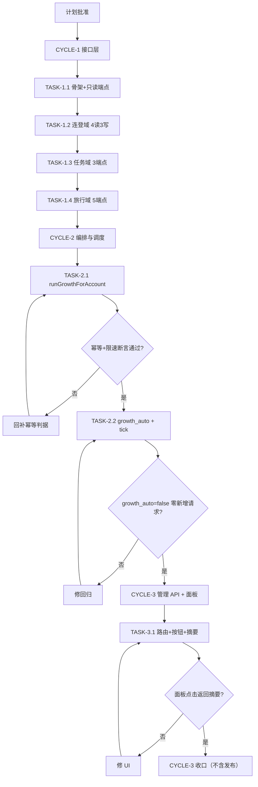
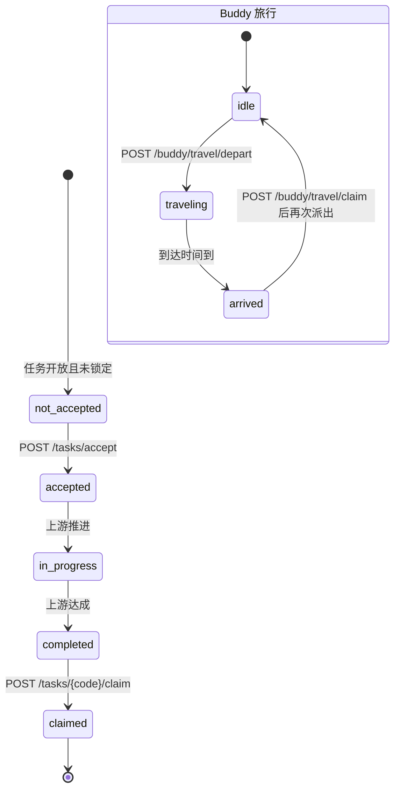
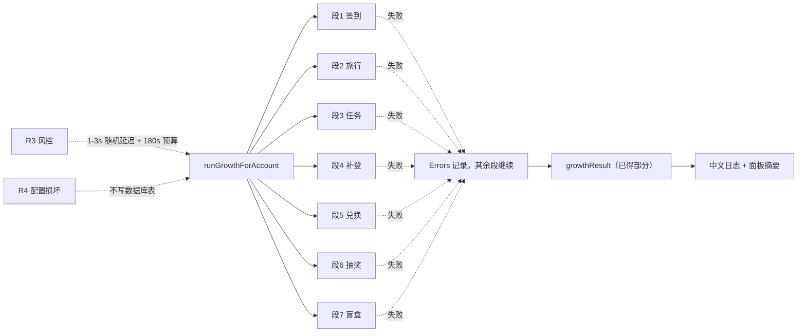

# WorkBuddy 国内版成长中心全自动领奖接入实施总览

- 编号：`IMPL-GROWTH-20261015`
- 需求编号：`REQ-GROWTH-2026-10-15`
- 触发：用户裁定（2026-10-15）采纳「全部 7 类玩法 + 复用每 4 小时 tick + 仅按钮与摘要 + 对齐外部项目风控节奏」
- 状态：已收口（CYCLE-1 ~ CYCLE-3 代码 + 本地验证完成；发布链路未执行，待用户单独授权）
- 最大推进边界：本轮最多推进到 CYCLE-3 收口；不执行发布链路；不重启生产 cpa 容器；不修改 `workbuddy-ai/` 与其它插件任何文件。

## 1. 当前计划最终方案简要说明

在 `workbuddy/`（CN 主插件）新增一个独立的 `growth.go` 成长中心客户端与编排层，把外部项目已逆向的 7 类领奖端点接入现有每 4 小时 tick，并在面板 CN 卡片上补一个「成长中心」按钮 + 一行结果摘要。选这个方案是因为：现有 `checkin.go` / `billing.go` 已经具备认证头、区域判定、重试、缓存合并、调度 tick 和面板事件委托的完整骨架，成长中心只需复用这些通道新增一层 API 封装，不需要新建调度器或改动流式链路；国际版（`workbuddy-ai/`）经本轮调研确认无成长中心，按用户决策本轮不动。

## 2. agent 对问题的理解

- **问题 / 目标**：插件目前只有 `daily-checkin` 一条签到链路，成长中心完全缺失；目标是把 7 类玩法落到 `workbuddy/` 插件并让用户可自动 / 手动触发。
- **本轮范围**：`workbuddy/` 的成长中心客户端、业务编排、调度接入、管理 API、面板按钮与摘要；覆盖 7 类玩法（每日签到状态、Buddy 旅行、成长任务、断签补登卡、连登阶梯兑换、盲盒抽奖、Buddy 能量盲盒）。
- **非范围**：`workbuddy-ai/` 国际版（无成长中心，本轮不动）；其它插件；`L0NE-6/WorkBuddy-Daily` 的小程序链式任务 / 主题换装 / 礼包补偿；多账号容器管理；国际版「自动活跃对话」；数据库表变更；发布链路。
- **当前优先闭环**：CYCLE-1 的 TASK-1.1 → TASK-1.4 全部通过端点契约验证（httptest 桩逐端点断言 + 探针脚本），再进入业务编排。
- **关键假设**：
  1. 成长中心 base 为 `{endpoint}/v2/activity/growth`，`{endpoint}` 取 auth 的 billing base（CN `https://www.codebuddy.cn`）。
  2. 鉴权头与现有 `billingHeaders()` 同族（`Authorization: Bearer` + `X-User-Id` + `X-Enterprise-Id` / `X-Tenant-Id` + `X-Domain`）。
  3. 写操作幂等性或返回业务「已领」码，可安全重复调用——**未经真实账号证实，故实现上写操作一律不重试**。
  4. 外部项目适配的客户端版本（2026-09 / 2026-10 活动版本）与当前生产账号一致。

## 3. 实施周期总览

| 周期 | 期次定位 | 周期目标 | 进入条件 | 收口条件 | 完成标志 |
| --- | --- | --- | --- | --- | --- |
| CYCLE-1 | 接口层（垂直切片） | 7 类端点全部封装且契约经 httptest 桩证实 | 计划批准 | TASK-1.1~1.4 全部闭环 | `growth.go` 可独立发起全部端点调用，单测全绿 |
| CYCLE-2 | 编排与调度 | 成长中心自动执行并接入 tick | CYCLE-1 收口 | TASK-2.1~2.2 闭环 | `growth_auto: true` 时每 4 小时自动领奖，日志可观测 |
| CYCLE-3 | 管理 API 与面板 | 用户可从面板触发并看到摘要 | CYCLE-2 收口 | TASK-3.1 闭环 | 面板 CN 卡片出现「成长中心」按钮与结果摘要 |

## 4. 代码落点目录树

```text
F:\cpa-plugin\workbuddy\
├── growth.go                              # 【新增】成长中心客户端 + 业务编排（919 行）
├── growth_test.go                         # 【新增】端点封装单测（27 例）
├── growth_orchestration_test.go           # 【新增】编排 / 幂等 / 限速单测（10 例）
├── growth_config_test.go                  # 【新增】growth_auto 解析与 tick 接入单测（4 例）
├── growth_handler_test.go                 # 【新增】管理路由单测（4 例）
├── billing.go                             # 【复用】billingCall / billingHeaders / isGlobalDomain / billingBaseFor 原样复用
├── checkin.go                             # 【改】runAutoCheckin / processAutoCheckinAccount 接入 growth 调用
├── usage_config.go                        # 【改】新增 growth_auto 配置解析
├── management.go                          # 【改】新增 POST /growth 路由与注册表条目
├── credits_handler.go                     # 【改】新增 handleGrowth / growthOneAccount
├── panel.go                               # 【改】dashboard 裁剪时调用 pruneGrowthLocks
├── panel.html                             # 【改】CN 卡片「成长中心」按钮 + 结果摘要行
├── main.go                                # 【改】var version = "0.16.0"
├── VERSION                                # 【改】0.15.10 → 0.16.0
└── CHANGELOG.md                           # 【改】记录 0.16.0 变更

F:\cpa-plugin\scripts\
└── probe_growth_endpoints.py              # 【新增】只读探针脚本（206 行）

F:\cpa-plugin\test\workbuddy\
├── growth_endpoints_mirror_test.go        # 【新增】镜像契约断言（2 例）
└── panel_growth_repro.mjs                 # 【新增】面板 DOM 回归脚本（13 断言）
```

## 5. 最小任务清单与执行结果

### CYCLE-1（接口层）

| 任务 | 目标 | 落点 | 状态 |
| --- | --- | --- | --- |
| TASK-1.1 | 客户端骨架 + 3 个只读端点（streak / heatmap / energy） | `growth.go`、`scripts/probe_growth_endpoints.py` | ✅ 完成 |
| TASK-1.2 | 连登域 4 读 3 写端点（redeem summary / lottery chances / energy + makeup-cards/use / redeem / lottery/draw） | `growth.go`、`growth_test.go` | ✅ 完成 |
| TASK-1.3 | 成长任务域 3 端点（tasks / tasks/accept 分批 20 / tasks/{code}/claim） | `growth.go`、`growth_test.go` | ✅ 完成 |
| TASK-1.4 | Buddy 旅行域 5 端点（travel status / config / claim / depart + buddy quota / open） | `growth.go`、`growth_test.go` | ✅ 完成 |

### CYCLE-2（编排与调度）

| 任务 | 目标 | 落点 | 状态 |
| --- | --- | --- | --- |
| TASK-2.1 | `runGrowthForAccount` 8 段编排 + 段隔离 + 幂等锁 + 限速 + 180s 预算 | `growth.go`、`growth_orchestration_test.go` | ✅ 完成 |
| TASK-2.2 | `growth_auto` 配置解析 + tick 接入 + Global 提前返回 | `usage_config.go`、`checkin.go`、`growth_config_test.go` | ✅ 完成 |

### CYCLE-3（管理 API 与面板）

| 任务 | 目标 | 落点 | 状态 |
| --- | --- | --- | --- |
| TASK-3.1 | `POST /growth` 路由 + `handleGrowth` + 面板按钮 / 摘要 + 版本号 | `management.go`、`credits_handler.go`、`panel.html`、`panel.go`、`VERSION`、`main.go`、`CHANGELOG.md` | ✅ 完成 |

## 6. 关键实现要点

1. **统一调用入口**：`growthCall`（GET 走 `billingRetryDelays` 重试 + `isTransientBillingErr` 分类；POST 单次调用不重试）→ `growthCallOnce`（组装 body、复用 `billingHeaders`、走 `hostHTTPDo`、解 `apiEnvelope`、错误片段经 `growthSnippet` 脱敏截断）。
2. **编排分段隔离**：`runGrowthForAccount` 按 8 段顺序执行（签到 → 旅行 → 任务 → 补登 → 兑换 → 抽奖 → 盲盒 → 汇总），每段独立 try，失败只记入 `growthResult.Errors`。
3. **幂等与限速**：账号级互斥锁 `growthLocks`（与 `checkinLocks` 分离，避免互相阻塞）；补登卡每轮 ≤ 1 张、抽奖每轮 ≤ 1 次；账号间 1–3s 随机延迟（`growthInterAccountDelayFn` 可桩化）；180s 总时长预算超时放弃并返回已得结果。
4. **零新增依赖**：`growthClientToken` 用 `crypto/rand` 生成 UUID v4（`u-<uuid>`）。
5. **锁表裁剪**：`pruneGrowthLocks()` 与 `pruneCheckinLocks()` 同形，在 `panel.go::buildDashboardEx` 的 dashboard 裁剪点被调用，避免 `sync.Map` 无界增长。
6. **Global 隔离**：`isGlobalDomain` 判定为 Global 的账号在 `processAutoCheckinAccount` 提前返回，不发任何成长请求；管理路由批量结果计入 `skipped_global`。

## 7. 真实测试安排

### 测试入口

- **编译 + vet + 单测（主入口）**：`python scripts/cgo-shim-build.py workbuddy`（本机无 CGO 工具链，输出 build + vet + test 全绿才算过）。
- **面板脚本语法校验**：`node --check`（或 `new Function()`）校验 `panel.html` 两个内联 `<script>` 块。
- **面板 DOM 回归**：`node test/workbuddy/panel_growth_repro.mjs`。
- **真实账号只读探针**：`python scripts/probe_growth_endpoints.py --readonly`（本机凭据缺失，记为 GAP-001 环境阻断）。

### 依赖环境

- Go 工具链 + `scripts/cgo-shim-build.py`（本机 Windows 无 gcc）。
- Node.js（面板脚本校验与 DOM 回归）。
- 本机已登录的 WorkBuddy CN 账号 auth 文件（`~/.antigravity_cockpit/workbuddy_accounts/`）——**本机为空**。
- local 配置的 CPA 实例（面板在线验证用）——**本机未监听 127.0.0.1:8317**。

### 样本 / 数据来源

- 单测样本：`httptest` 内置桩，响应 JSON 按 EXT-1 记录的真实字段形态构造（`task_code` / `accept_status` / `reward_credit` / `record_id` / `state` / `makeup_cards.balance` 等）。
- 契约参照：EXT-1 `88lin/workbuddy-auto-signin` 的 `signin.py`（2026-10 活动版本）。

### 通过标准与实际结果

| 项 | 标准 | 实际 |
| --- | --- | --- |
| cgo-shim-build | build + vet + test 全绿 | ✅ `all green (workbuddy)`（23.4s，成长中心 45 例包内 + 2 例 test/ 镜像，均参与编译） |
| 面板 DOM 回归 | 13 断言全 PASS | ✅ `[回归] PASS 全部断言通过` |
| 面板脚本语法 | 两个 `<script>` 块 `node --check` rc=0 | ✅ blocks=2 rc=0 |
| 编排 4 组断言 | 全绿路径 / 段隔离 / 幂等 / 限速 | ✅ 全部通过 |
| `growth_auto: false` 回归 | 零新增上游请求 | ✅ `TestGrowthAutoConfig_AbsentKeyDisables` 通过 |
| 真实账号只读探针 | 7 类端点只读部分 HTTP 200 | ⚠️ 环境阻断（GAP-001） |
| local 面板在线点击 | 按钮出现 + 摘要渲染 | ⚠️ 环境阻断（GAP-002），改用 DOM 回归替代 |
| 测试污染扫描 | POLLUTION: PASS | ⚠️ 唯一阻断项落 `Python/pythoncore-3.15-64/` 第三方树，与本轮无关 |

## 8. 任务完成条件 / 停止条件 / 最大推进边界

| 任务 | 完成条件 | 停止 / 结束条件 | 实际 |
| --- | --- | --- | --- |
| TASK-1.1 | 3 只读端点契约证实 + 单测全绿 | 端点 404/403 或字段不符 → 停并修契约 | ✅ 达成 |
| TASK-1.2 | 4 只读 + 6 函数单测全绿 | 写端点非幂等 → 停并降级为只读展示 | ✅ 达成（写操作一律不重试） |
| TASK-1.3 | 任务列表契约证实 + 单测全绿 | `/tasks` 缺 `task_code` → 停并修契约 | ✅ 达成 |
| TASK-1.4 | 3 只读端点契约证实 + 单测全绿 | `depart` 无合法 `location_id` → 停并登记阻断 | ✅ 达成 |
| TASK-2.1 | 4 组单测全绿 + vet 无告警 | 幂等断言失败 → 停并回补幂等判据 | ✅ 达成 |
| TASK-2.2 | 配置 + tick 单测全绿 + 回归断言通过 | `growth_auto:false` 有新增请求 → 停并修回归 | ✅ 达成 |
| TASK-3.1 | 单测全绿 + 面板语法通过 + `6-review` PASS | 面板无响应 / 摘要不渲染 → 停并修 UI | ✅ 达成（在线点击部分记 GAP-002） |

- **最大推进边界**：本轮最多推进到 CYCLE-3 收口（代码 + 本地验证完成）。不执行发布链路；不重启生产 cpa 容器；不修改 `workbuddy-ai/` 与其它插件任何文件。

## 9. 风险与处置

| ID | 风险 | 处置 | 状态 |
| --- | --- | --- | --- |
| R1 | 成长中心端点未公开文档，全靠逆向，可能随时变更 | 每段独立 try；错误分类沿用 `isTransientBillingErr`；探针第一时间暴露变更 | 长期风险（GAP-003） |
| R2 | 写操作幂等性未证实，重复调用可能重复扣减 | 写操作一律不重试；补登卡 ≤1/轮、抽奖 ≤1/轮；账号级互斥锁 | 未关闭（GAP-004） |
| R3 | 频繁调用触发上游风控 | 账号间 1–3s 随机延迟；180s 总预算；复用既有 6 槽 tick | 已缓解 |
| R4 | 生产 `config_store` 表误写导致配置损坏 | 本轮不写任何数据库表；`growth_auto` 只走 config_yaml 解析 | 已规避 |
| R5 | 探针脚本回显凭据 | 脚本只打印 HTTP 状态与响应顶层字段名；显式过滤 token/UID | 已规避 |
| R6 | `growth_auto` 默认 `false` 与用户期望「装上即自动跑」不符 | 用户已决策默认 `false`（先验证再开）；后续可另立任务改为默认 `true` | 已决策 |

## 10. 外部项目代码引用清单（EXT-*）

| ID | 可复现地址 | 版本 / 提交 | 项目根相对路径 / 文件·符号 | 引用用途 | 许可证 / 复制边界 | 验证回指 |
| --- | --- | --- | --- | --- | --- | --- |
| EXT-1 | `https://github.com/88lin/workbuddy-auto-signin` | 主分支，核心逻辑 2026-10 活动版本；`https://raw.githubusercontent.com/88lin/workbuddy-auto-signin/main/signin.py` | `signin.py`：`build_headers()`、`run_growth()`、各端点常量 | 提供 7 类端点的路径、method、body 字段、响应字段与业务流程顺序 | 未声明许可证；**只引用接口契约事实，不复制源码**，Go 侧完全独立实现 | `growth.go` 端点常量 + `growth_test.go` httptest 断言 |
| EXT-2 | `https://github.com/autumnsentiment/workbuddy-helper` | v1.0.8 | 端点常量、`DefaultActivePrompt`、活跃遥测流程 | 对照国内版签到端点与「国际版活跃积分」机制，支撑本轮不动国际版的决策 | 未声明许可证；仅作对照阅读，不复制源码 | 需求文档 §一 背景 + CYCLE-1 范围界定 |
| EXT-3 | `https://github.com/L0NE-6/WorkBuddy-Daily` | 主分支 | 单文件 Python，33 项玩法与端点常量 | 交叉印证成长中心端点集合与国内 / 国际版差异 | 未声明许可证；仅作端点交叉印证，不复制源码 | 需求文档 §一 背景 |

## 11. 图形化执行路径

**图 1（流程，关联 CYCLE-1~3 / TASK-1.1~3.1）**：实现与验证主链路。



**图 2（状态，关联 TASK-1.3 / TASK-1.4）**：上游状态机，决定是否发起写操作。



**图 3（风险，关联 R1~R4）**：失败隔离与降级路径。



## 12. 跨会话独立执行清单

- **主项目地址**：`https://github.com/luode0320/cpa-workbuddy-plugin`（物理目录 `F:\cpa-plugin`）。
- **仓库类型**：Go c-shared（`import "C"`）CPA 插件多包单仓。
- **代码基线**：`workbuddy/` VERSION `0.16.0`，`workbuddy/main.go` `var version = "0.16.0"`。
- **新会话接手第一步**：读 `workbuddy/growth.go`（919 行）确认函数结构；读 `workbuddy/checkin.go`、`workbuddy/management.go`、`workbuddy/usage_config.go`、`workbuddy/panel.html` 确认接入点未漂移。
- **中断点核验顺序**：① `python scripts/cgo-shim-build.py workbuddy` 看当前测试状态 → ② 检查 `growth.go` 函数清单是否完整（39 个函数）→ ③ 对照本总览 §5 定位未闭环任务。
- **后续待办**：GAP-001 / GAP-002 的真实环境验证（需用户在具备本地 CN 账号凭据 + 本地 CPA 的环境执行）；发布链路（需用户单独授权）。
