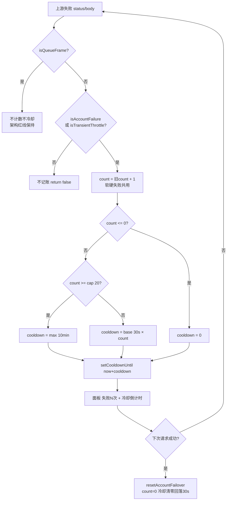

# 需求实施总览：全插件账号故障冷却阶梯化（30s 递增至 10 分钟封顶）

结论：把 7 个 provider 插件账号失败后的固定 15s 冷却统一改为「30s × 连续失败次数、10 分钟封顶」的阶梯递增冷却，软失败（瞬时过载）与硬失败共用同一条计数阶梯；影响：全部 7 个 provider 插件的故障账号路由排除节奏与面板「失败 N 次」冷却时长展示；范围：workbuddy（已完成）、workbuddy-ai、qoderwork、qoder-ai、traework 五个同族插件的 `accountFailover.go` + `policy.go` 注释，copilot、zcode 两个异构插件的 `failover.go`，以及对应单测与 `test/` 镜像同步；非范围：Qoder 110 日限额 24 小时持久化冷却（`daily_cooling` 独立机制）、排队帧 `isQueueFrame` 不计数不冷却策略、上游配额规则、版本号 bump 与发布链路；变化：账号连续失败越多冷却越久（30s→60s→90s…→10min 封顶），任意一次成功请求即清零回落到 30s，软失败抖动期间账号会沿阶梯冷却更久；完成标准：7 插件 `cgo-shim-build.py` build+vet+test 全绿，阶梯递增断言与封顶断言通过，注释口径与代码一致；术语说明：阶梯冷却（cooldown = base × consecutiveFailCount，封顶 max）、软失败（429 无额度标记 / 软限流文案 / 上游零字节断流，`isTransientThrottle` 判定）、排队帧（`isQueueFrame`，上游容量状态非账号故障）；验证状态：周期 1（workbuddy）已实施完成并 build+vet+test 全绿，周期 2/3/4 待实施。

## 1. 当前计划最终方案简要说明
- 推荐方案一句话结论：以 workbuddy 为样板，把同族插件 `accountFailover.go` 的固定 15s 冷却改为 `failoverCooldownFor(count)` 阶梯函数（30s 基数、20 档封顶 10min），删除 `coolDownAccount` 软失败旁路让软硬失败共用计数阶梯；异构插件在 `failover.go` 新增同名阶梯函数并改 `noteAccountFailure` 调用点。
- 主落点 / 主路径：同族 5 插件 `<plugin>/accountFailover.go`（常量组 + `failoverCooldownFor` + `recordAccountFailure`）与 `<plugin>/policy.go`（`isTransientThrottle` 注释）；异构 2 插件 `<plugin>/failover.go`（常量组 + 新增 `failoverCooldownFor` + `noteAccountFailure`）；测试 `<plugin>/accountFailover_test.go`、`<plugin>/accountFailover_softfail_test.go`、`test/traework/account_failover_softfail_test.go`。
- 为什么先走这条路线：5 个同族插件的 `accountFailover.go` 结构一致（`const failoverCooldown` + 固定返回的 `failoverCooldownFor` + `coolDownAccount` 旁路），可整文件级对齐样板；copilot/zcode 是 `failoverEntry{failCount,cooldown}` 异构结构、无阶梯函数，需单独适配，放周期 3。

## 2. 基本信息
- 对应需求文档：用户实时需求对话（2026-10-16「固定 15s 改 30s 递增阶梯、最大 10 分钟」）
- 来源对象标识（需求或 Bug）：REQ-FAILOVER-COOLDOWN-LADDER-20261016
- 当前实施文档命名主干：`2026-10-17_000848_全插件账号故障冷却阶梯化实施总览`
- 对应需求与实施计划全量顺序实施方案：N/A（单一来源对象、单仓库内 7 插件同构同步，无需跨需求总表）
- 实施计划完成条件（`AC-*`）所在章节：第 5 节最小任务清单各任务的「任务完成条件」
- 对应 `6-review` 风格回归记录：待周期 4 生成 `doc/6-review/2026-10-17_*_全插件冷却阶梯化_6-review.md`
- agent 理解的问题 / 目标：账号故障后固定 15s 冷却对「持续失败的坏账号」退避不足（15s 后立即重新承接流量制造二次失败），需改为按连续失败次数递增的阶梯冷却，让坏账号越失败越久地被排除，同时保留「一次成功即清零」的快速恢复。
- 当前计划范围：
  1. 同族 5 插件（workbuddy/workbuddy-ai/qoderwork/qoder-ai/traework）`accountFailover.go` 阶梯化：常量组 `failoverCooldownBase/Max/LadderCap`、`failoverCooldownFor(count)` 阶梯计算、删除 `coolDownAccount` 旁路、`recordAccountFailure` 软硬失败共用计数阶梯；
  2. 同族 5 插件 `policy.go` 的 `isTransientThrottle` 注释同步新语义（函数保留，仍用于把 HTTP 200 承载的零字节断流纳入记账范围）；
  3. 异构 2 插件（copilot/zcode）`failover.go` 阶梯化：新增三常量与 `failoverCooldownFor(count)`，`noteAccountFailure` 改 `entry.cooldown = time.Now().Add(failoverCooldownFor(entry.failCount))`；
  4. 测试同步：各插件 `accountFailover_test.go` 阶梯/封顶断言、`accountFailover_softfail_test.go` 软失败从「count 恒 0」改「count 递增 + 阶梯冷却」、traework `test/` 镜像同步；
  5. 各插件 `accountFailover.go` 文件头与相关注释口径同步（`fixed 15s` → 阶梯），跨仓 `AGENTS.md`「1/3/10 分钟阶梯退避」表述订正。
- 明确不在范围：
  1. Qoder 系 `isDailyCountExceeded`（110 日限额）的 24 小时 `daily_cooling` 持久化冷却——独立机制，本轮不动；
  2. 排队帧 `isQueueFrame` 的「不计数不冷却」策略——架构红线（见项目记忆 `project-qoder-queue-frame-not-account-fault`），必须保持；
  3. 上游配额规则、面板 UI 交互逻辑、版本号 bump 与 CI 发布链路。
- 当前优先闭环：周期 1 完成 workbuddy 样板并全绿（已完成）；周期 2 镜像同步 4 个同族插件；周期 3 适配 2 个异构插件；周期 4 注释与跨仓文档口径收口。
- 关键假设 / 待确认点：
  1. 软失败并入阶梯（用户裁定 A 选①）：接受「网关抖动期间账号沿阶梯冷却更久」的代价，由「一次成功即清零」兜底；
  2. 统一 10 分钟上限（用户裁定 B 选①）：软硬失败共用同一封顶，不为软失败单设 2 分钟上限；
  3. 阶梯基数 30s、封顶 10min、档位 cap=20（`int(10min/30s)`）；`failoverCooldownFor(count)` 在 `count>=cap` 时返回 `max`，先比较次数再相乘避免溢出。
- 跨会话执行入口：新会话读取本文档 + `workbuddy/accountFailover.go`（样板）即可无缝接续未完成的周期 2/3/4。
- 主项目地址、仓库类型与代码基线：`F:\cpa-plugin`，Git 仓库，基线为当前工作树（含 workbuddy 0.16.2 成果）。
- local 环境与依赖入口：`python scripts/cgo-shim-build.py <plugin>`（Windows 无 CGO，统一走 shim；build+vet+test 全绿才算过）。
- 外部项目代码引用：N/A（纯本仓库 Go 代码同构同步，无外部项目代码引用）。
- 当前状态：周期 1 已完成并全绿，周期 2/3/4 待实施。
- 是否已获得开始实施授权：是（用户「A 选① B 选① 开始实施」+「继续」）。

## 2.1 决策维度覆盖表

| 维度 | 状态 | 结论 / 依据 / 用户所选项 |
| --- | --- | --- |
| 架构 / 技术路线 | 已确定 | 阶梯冷却 `cooldown = base × count`，`base=30s`、`max=10min`、`cap=20` 档封顶 |
| 代码落点 | 已确定 | 同族 5 插件 `accountFailover.go`+`policy.go`；异构 2 插件 `failover.go` |
| 实现方式 | 已确定 | 同族整文件对齐 workbuddy 样板；异构新增 `failoverCooldownFor` 并改 `noteAccountFailure` |
| 软失败处理（裁定 A） | 已弹窗且用户已选 | **①软失败也计入阶梯**（删除 `coolDownAccount` 旁路，软硬共用计数） |
| 软失败上限（裁定 B） | 已弹窗且用户已选 | **①统一 10 分钟上限**（不为软失败单设 2 分钟上限） |
| 命名 | 已确定 | `failoverCooldownBase` / `failoverCooldownMax` / `failoverCooldownLadderCap` / `failoverCooldownFor` |
| 注释 | 已确定 | 中文表达，函数头标 `[参数]/[返回]/最近修改时间`，`fixed 15s` 全量订正为阶梯 |
| 错误处理 | 已确定 | `count<=0` 返回 0；`count>=cap` 返回 `max`；先比较后相乘防溢出 |
| 数据模型 | 已确定 | 复用现有 `authFailoverState{count,cooldownUntil}` / `failoverEntry{failCount,cooldown}`，不改结构 |
| 接口契约 | 已确定 | `failoverCooldownFor(count int) time.Duration` 全插件统一签名 |
| 依赖与库 | 已确定 | 仅标准库 `time`，无新增依赖 |
| 测试策略 | 已确定 | 阶梯递增断言表 + 封顶断言 + 软失败计数递增断言 + shim 全绿 |

## 2.2 待用户选择清单
- 无（裁定 A、B 两个真实不确定决策点已由用户选定：软失败计入阶梯、统一 10 分钟上限）。

## 2.3 跨会话独立执行与外部项目代码引用清单
- 新会话接手第一步：`python scripts/cgo-shim-build.py workbuddy` 确认样板基线全绿，再按周期 2→3→4 顺序推进未完成插件。
- 主项目地址与项目根：`F:\cpa-plugin`
- 主项目代码基线：当前工作树（workbuddy 周期 1 已改完）
- 计划源文件与版本：`doc/3-实施/2026-10-17_000848_全插件账号故障冷却阶梯化实施总览.md`
- 依赖安装、local 配置和服务启动入口：无需额外依赖；验证入口 `python scripts/cgo-shim-build.py <plugin>`
- 中断点核验顺序：① 样板 workbuddy 是否全绿 → ② 各插件 `accountFailover.go` 是否已删 `coolDownAccount`、`failoverCooldownFor` 是否阶梯化 → ③ 对应测试是否改阶梯断言 → ④ copilot/zcode `failover.go` 是否新增阶梯函数
- 外部项目代码引用：N/A（本轮为项目内 7 插件同构同步，无外部项目代码引用）。

| 引用 ID | 外部项目名称 | 外部项目地址 | 版本 / 提交 | 项目根相对路径 | 文件 / 符号 | 引用用途 | 许可证 / 复制边界 | 可达性检查与失败停止条件 | 使用 TASK / TEST / EVIDENCE 回指 |
| --- | --- | --- | --- | --- | --- | --- | --- | --- | --- |
| N/A | 无外部引用 | — | — | — | — | 纯本仓库同构同步 | — | — | — |

## 3. 实施周期总览
- 总周期说明：按「样板先行 → 同族镜像 → 异构适配 → 口径收口」四周期推进，每周期独立可验证、独立全绿。
- 本次计划拆分的子任务周期数：4
- 周期拆分原则：同族插件结构一致可批量对齐样板（周期 2）；异构插件需单独适配（周期 3）；注释与文档口径统一收口（周期 4）。
- 周期排序说明：周期 1 建立样板并验证方案可行 → 周期 2 复制到 4 个同族插件 → 周期 3 适配 2 个异构插件 → 周期 4 全仓注释与跨仓文档口径同步。
- 周期 1（workbuddy 阶梯化样板）：
  - 周期序号 / 期次定位：第一期，样板与方案验证
  - 周期目标：workbuddy `accountFailover.go` 阶梯化 + `policy.go` 注释 + 单测改阶梯断言，shim 全绿
  - 本周期包含的最小任务：TASK-1（已完成）
  - 周期内最小任务执行顺序：TASK-1
  - 进入条件：用户裁定 A/B 已选
  - 收口条件：`python scripts/cgo-shim-build.py workbuddy` build+vet+test 全绿
  - 完成标志：**已达成**（26.078s / 25.796s 两次全绿）
  - 与前后周期衔接：作为周期 2 同族插件的对齐样板
- 周期 2（同族 4 插件镜像同步）：
  - 周期序号 / 期次定位：第二期，同构批量同步
  - 周期目标：workbuddy-ai / qoderwork / qoder-ai / traework 对齐 workbuddy 样板
  - 本周期包含的最小任务：TASK-2、TASK-3、TASK-4、TASK-5
  - 周期内最小任务执行顺序：TASK-2 → TASK-3 → TASK-4 → TASK-5（每个独立全绿后再下一个）
  - 进入条件：周期 1 全绿
  - 收口条件：4 插件各自 `cgo-shim-build.py <plugin>` 全绿
  - 完成标志：4 插件 build+vet+test 全绿
  - 与前后周期衔接：为周期 3 异构适配提供同族参照
- 周期 3（异构 2 插件适配）：
  - 周期序号 / 期次定位：第三期，异构结构适配
  - 周期目标：copilot / zcode `failover.go` 新增阶梯函数并改调用点
  - 本周期包含的最小任务：TASK-6、TASK-7
  - 周期内最小任务执行顺序：TASK-6 → TASK-7
  - 进入条件：周期 2 全绿
  - 收口条件：2 插件各自 `cgo-shim-build.py <plugin>` 全绿
  - 完成标志：copilot / zcode build+vet+test 全绿
  - 与前后周期衔接：全部 7 插件行为一致后进入周期 4 口径收口
- 周期 4（注释与跨仓文档口径同步）：
  - 周期序号 / 期次定位：第四期，口径收口
  - 周期目标：全仓 `fixed 15s` 残留订正、`AGENTS.md` 阶梯退避表述订正、6-review 风格回归
  - 本周期包含的最小任务：TASK-8
  - 周期内最小任务执行顺序：TASK-8
  - 进入条件：周期 3 全绿
  - 收口条件：grep 无残留旧表述、6-review `STYLE: PASS`
  - 完成标志：注释与代码一致、跨仓文档订正、6-review 通过
  - 与前后周期衔接：交付收口
- 总体真实测试安排：
  - 真实测试安排是否默认必需：是（涉及生产代码行为变更）
  - 覆盖哪些最小任务：TASK-1~7（每个插件改动后 shim 全绿）；TASK-8 纯注释/文档免测（写明理由）
  - 公共测试环境 / 依赖：Windows + `python scripts/cgo-shim-build.py <plugin>`（内置 WSL/gcc 桥）
  - 公共样本 / 数据来源：各插件 `accountFailover_test.go` / `accountFailover_softfail_test.go` 内置断言样本
  - 总体通过标准：7 插件 build+vet+test 全绿，阶梯递增与封顶断言通过

## 4. 阶段计划
- 阶段 1：阶梯函数与常量组（`accountFailover.go` / `failover.go`）
  - 阶段目标：把固定 15s 替换为 `failoverCooldownFor(count)` 阶梯计算
  - 只做这一件事：改常量组 + `failoverCooldownFor`，不动分类逻辑
  - 输入条件：样板已定（workbuddy）
  - 输出产物：各插件阶梯函数
  - 验证门槛：`failoverCooldownFor` 单元断言（1→30s、2→60s、20→10min、21→10min）
- 阶段 2：软失败并入计数（删除 `coolDownAccount` 旁路）
  - 阶段目标：软硬失败共用同一条计数 + 阶梯路径
  - 只做这一件事：删旁路函数 + 改 `recordAccountFailure`/`noteAccountFailure` 分支
  - 输入条件：阶段 1 完成
  - 输出产物：统一记账路径
  - 验证门槛：软失败断言从「count 恒 0」改「count 递增 + 阶梯冷却」并通过
- 阶段 3：注释与文档口径同步
  - 阶段目标：消除 `fixed 15s` 残留、订正跨仓 `AGENTS.md`
  - 只做这一件事：注释/文档文字，不动逻辑
  - 输入条件：阶段 1、2 全绿
  - 输出产物：一致的注释与文档
  - 验证门槛：grep 无残留、6-review `STYLE: PASS`

## 5. 最小任务清单

- 最小任务 1（TASK-1，已完成）：
  - 任务名：workbuddy 阶梯化样板
  - 所属周期：周期 1；周期内顺序：1；所属阶段：阶段 1+2
  - 本任务只做这一件事：workbuddy `accountFailover.go` 阶梯化 + `policy.go` 注释 + 单测改阶梯断言
  - 垂直切片目标：单插件端到端（生产代码 + 测试）阶梯冷却可验证
  - 输入条件：裁定 A/B 已选
  - 实现产出：`failoverCooldownBase/Max/LadderCap` 常量、`failoverCooldownFor`、删 `coolDownAccount`、`recordAccountFailure` 统一路径、7 处 `fixed 15s` 注释订正
  - 真实测试是否必需：是
  - 真实测试入口：`python scripts/cgo-shim-build.py workbuddy`
  - 真实测试依赖环境：Windows + shim（WSL/gcc 桥）
  - 真实测试样本 / 数据来源：`accountFailover_test.go`、`accountFailover_softfail_test.go`
  - 真实测试通过标准：build+vet+test 全绿
  - 测试点：阶梯递增（30/60/90/120s）、封顶（count≥20→10min）、软失败计数递增、成功后清零、冷却到期
  - `6-review` 风格回归点：中文注释元信息、命名一致性、无残留旧表述
  - 任务完成条件（AC-1）：shim 全绿 **且** `failoverCooldownFor` 阶梯/封顶断言通过 **且** 软失败改阶梯计数通过 **且** workbuddy 目录无 `fixed 15s` failover 残留
  - 任务停止 / 结束条件：shim 全绿即收口
  - 阻断条件：shim 非全绿
  - 前置依赖：无；下一任务依赖：本任务作为周期 2 样板
  - 预计触达文件数：4（accountFailover.go / policy.go / accountFailover_test.go / accountFailover_softfail_test.go）+ 5 处旁文件注释
  - **状态：已完成**（两次 shim 全绿：26.078s、25.796s）

- 最小任务 2（TASK-2）：
  - 任务名：workbuddy-ai 同步阶梯
  - 所属周期：周期 2；周期内顺序：1；所属阶段：阶段 1+2
  - 本任务只做这一件事：workbuddy-ai 对齐 workbuddy 样板
  - 垂直切片目标：workbuddy-ai 端到端阶梯冷却可验证
  - 输入条件：TASK-1 全绿（样板）
  - 实现产出：`accountFailover.go` 阶梯化（删 `coolDownAccount` @line166、改 `recordAccountFailure` @line216）、`policy.go` `isTransientThrottle` 注释、`accountFailover_test.go` 阶梯断言
  - 真实测试是否必需：是
  - 真实测试入口：`python scripts/cgo-shim-build.py workbuddy-ai`
  - 真实测试依赖环境：Windows + shim
  - 真实测试样本 / 数据来源：`workbuddy-ai/accountFailover_test.go`（注意：workbuddy-ai 无 softfail 测试文件，只改 test 主文件）
  - 真实测试通过标准：build+vet+test 全绿
  - 测试点：阶梯递增、封顶、冷却到期
  - `6-review` 风格回归点：与 workbuddy 样板逐函数对齐、命名一致
  - 任务完成条件（AC-2）：shim 全绿 **且** 阶梯/封顶断言通过 **且** 无 `coolDownAccount` 残留 **且** 注释口径与样板一致
  - 任务停止 / 结束条件：shim 全绿即收口
  - 阻断条件：shim 非全绿；workbuddy-ai 结构与样板出现非预期差异（需停下核对）
  - 前置依赖：TASK-1；下一任务依赖：无（TASK-3 可并行但写集独立，默认串行）
  - 预计触达文件数：3

- 最小任务 3（TASK-3）：
  - 任务名：qoderwork 逐函数适配阶梯
  - 所属周期：周期 2；周期内顺序：2；所属阶段：阶段 1+2
  - 本任务只做这一件事：qoderwork 对齐样板，保留 `isDailyCountExceeded` 独立 24h 冷却不动
  - 垂直切片目标：qoderwork 端到端阶梯冷却可验证
  - 输入条件：TASK-1 全绿
  - 实现产出：`accountFailover.go` 阶梯化（删 `coolDownAccount` @line170、改 `recordAccountFailure` @line229）、`policy.go` 注释、`accountFailover_test.go` + `accountFailover_softfail_test.go` 阶梯断言
  - 真实测试是否必需：是
  - 真实测试入口：`python scripts/cgo-shim-build.py qoderwork`
  - 真实测试依赖环境：Windows + shim
  - 真实测试样本 / 数据来源：`qoderwork/accountFailover_test.go`、`qoderwork/accountFailover_softfail_test.go`
  - 真实测试通过标准：build+vet+test 全绿
  - 测试点：阶梯递增、封顶、软失败计数递增、110 日限额仍走 `daily_cooling`（不受本轮影响）
  - `6-review` 风格回归点：`isDailyCountExceeded` 分支保持不变、命名一致
  - 任务完成条件（AC-3）：shim 全绿 **且** 阶梯/封顶/软失败断言通过 **且** `daily_cooling` 相关测试仍绿 **且** 无 `coolDownAccount` 残留
  - 任务停止 / 结束条件：shim 全绿即收口
  - 阻断条件：shim 非全绿；误改 `isDailyCountExceeded`/`daily_cooling` 逻辑
  - 前置依赖：TASK-1；下一任务依赖：无
  - 预计触达文件数：4

- 最小任务 4（TASK-4）：
  - 任务名：qoder-ai 逐函数适配阶梯
  - 所属周期：周期 2；周期内顺序：3；所属阶段：阶段 1+2
  - 本任务只做这一件事：qoder-ai 对齐样板（与 qoderwork 同族，含 `isDailyCountExceeded`）
  - 垂直切片目标：qoder-ai 端到端阶梯冷却可验证
  - 输入条件：TASK-1 全绿
  - 实现产出：`accountFailover.go` 阶梯化（删 `coolDownAccount` @line170、改 `recordAccountFailure` @line229）、`policy.go` 注释、`accountFailover_test.go` + `accountFailover_softfail_test.go` 阶梯断言
  - 真实测试是否必需：是
  - 真实测试入口：`python scripts/cgo-shim-build.py qoder-ai`
  - 真实测试依赖环境：Windows + shim
  - 真实测试样本 / 数据来源：`qoder-ai/accountFailover_test.go`、`qoder-ai/accountFailover_softfail_test.go`
  - 真实测试通过标准：build+vet+test 全绿
  - 测试点：阶梯递增、封顶、软失败计数递增、110 日限额仍走 `daily_cooling`
  - `6-review` 风格回归点：与 qoderwork 保持一致、`isDailyCountExceeded` 不动
  - 任务完成条件（AC-4）：shim 全绿 **且** 阶梯/封顶/软失败断言通过 **且** `daily_cooling` 测试仍绿 **且** 无 `coolDownAccount` 残留
  - 任务停止 / 结束条件：shim 全绿即收口
  - 阻断条件：shim 非全绿；误改 `daily_cooling`
  - 前置依赖：TASK-1；下一任务依赖：无
  - 预计触达文件数：4

- 最小任务 5（TASK-5）：
  - 任务名：traework 阶梯化 + test/ 镜像同步
  - 所属周期：周期 2；周期内顺序：4；所属阶段：阶段 1+2
  - 本任务只做这一件事：traework 对齐样板，同步 `test/traework/account_failover_softfail_test.go` 镜像
  - 垂直切片目标：traework 端到端阶梯冷却可验证（含镜像测试）
  - 输入条件：TASK-1 全绿
  - 实现产出：`accountFailover.go` 阶梯化（删 `coolDownAccount` @line153、改 `recordAccountFailure` @line203）、`policy.go` 注释、`traework/accountFailover_test.go` 阶梯断言、`test/traework/account_failover_softfail_test.go` 镜像同步软失败阶梯断言
  - 真实测试是否必需：是
  - 真实测试入口：`python scripts/cgo-shim-build.py traework`
  - 真实测试依赖环境：Windows + shim
  - 真实测试样本 / 数据来源：`traework/accountFailover_test.go`（源）、`test/traework/account_failover_softfail_test.go`（镜像，147 行）
  - 真实测试通过标准：build+vet+test 全绿
  - 测试点：阶梯递增、封顶、软失败计数递增；镜像与源断言一致
  - `6-review` 风格回归点：源与镜像同步、命名一致
  - 任务完成条件（AC-5）：shim 全绿 **且** 阶梯/封顶/软失败断言通过 **且** `test/` 镜像与源目录断言一致 **且** 无 `coolDownAccount` 残留
  - 任务停止 / 结束条件：shim 全绿即收口
  - 阻断条件：shim 非全绿；镜像与源不一致
  - 前置依赖：TASK-1；下一任务依赖：无
  - 预计触达文件数：5

- 最小任务 6（TASK-6）：
  - 任务名：copilot 异构结构阶梯化
  - 所属周期：周期 3；周期内顺序：1；所属阶段：阶段 1
  - 本任务只做这一件事：copilot `failover.go` 新增阶梯函数并改 `noteAccountFailure`
  - 垂直切片目标：copilot 端到端阶梯冷却可验证
  - 输入条件：周期 2 全绿
  - 实现产出：`copilot/failover.go` 删 `const failoverCooldown=15s`（@line23）、新增 `failoverCooldownBase/Max/LadderCap` + `failoverCooldownFor(count)`、`noteAccountFailure` 改 `entry.cooldown = time.Now().Add(failoverCooldownFor(entry.failCount))`（@line58）
  - 真实测试是否必需：是
  - 真实测试入口：`python scripts/cgo-shim-build.py copilot`
  - 真实测试依赖环境：Windows + shim
  - 真实测试样本 / 数据来源：`copilot/scheduler_test.go`、`copilot/management_test.go`（现有 failover 相关断言），按需补阶梯断言
  - 真实测试通过标准：build+vet+test 全绿
  - 测试点：阶梯递增、封顶、`failCount` 递增驱动冷却增长
  - `6-review` 风格回归点：异构结构下命名与同族 `failoverCooldownFor` 签名一致
  - 任务完成条件（AC-6）：shim 全绿 **且** `noteAccountFailure` 走阶梯 **且** 阶梯/封顶断言通过 **且** 无 `const failoverCooldown` 固定值残留
  - 任务停止 / 结束条件：shim 全绿即收口
  - 阻断条件：shim 非全绿；异构结构缺 `failoverCooldownFor` 落点（需停下核对）
  - 前置依赖：周期 2；下一任务依赖：无
  - 预计触达文件数：2（failover.go + 测试）

- 最小任务 7（TASK-7）：
  - 任务名：zcode 异构结构阶梯化
  - 所属周期：周期 3；周期内顺序：2；所属阶段：阶段 1
  - 本任务只做这一件事：zcode `failover.go` 新增阶梯函数并改 `noteAccountFailure`（与 copilot 同构）
  - 垂直切片目标：zcode 端到端阶梯冷却可验证
  - 输入条件：周期 2 全绿
  - 实现产出：`zcode/failover.go` 删 `const failoverCooldown=15s`（@line23）、新增三常量 + `failoverCooldownFor`、`noteAccountFailure` 改阶梯（@line58）
  - 真实测试是否必需：是
  - 真实测试入口：`python scripts/cgo-shim-build.py zcode`
  - 真实测试依赖环境：Windows + shim
  - 真实测试样本 / 数据来源：`zcode/scheduler_test.go`，按需补阶梯断言
  - 真实测试通过标准：build+vet+test 全绿
  - 测试点：阶梯递增、封顶、`failCount` 驱动冷却
  - `6-review` 风格回归点：与 copilot 保持一致
  - 任务完成条件（AC-7）：shim 全绿 **且** `noteAccountFailure` 走阶梯 **且** 阶梯/封顶断言通过 **且** 无固定值残留
  - 任务停止 / 结束条件：shim 全绿即收口
  - 阻断条件：shim 非全绿
  - 前置依赖：周期 2；下一任务依赖：无
  - 预计触达文件数：2

- 最小任务 8（TASK-8）：
  - 任务名：注释与跨仓文档口径同步
  - 所属周期：周期 4；周期内顺序：1；所属阶段：阶段 3
  - 本任务只做这一件事：消除全仓 `fixed 15s` failover 残留表述、订正 `AGENTS.md`「1/3/10 分钟阶梯退避」为「30s 递增至 10 分钟封顶」、6-review 风格回归
  - 垂直切片目标：注释/文档与代码行为一致
  - 输入条件：周期 3 全绿
  - 实现产出：各插件残留注释订正、`AGENTS.md` 表述订正、6-review 记录
  - 真实测试是否必需：否
  - 真实测试入口：N/A
  - 真实测试依赖环境：N/A
  - 真实测试样本 / 数据来源：N/A
  - 真实测试通过标准：N/A（免测理由：纯注释与文档文字，不改任何运行逻辑，不影响编译产物行为）
  - 测试点：grep 无 `fixed 15s` failover 残留（排除 HTTP 预算/docker pull 等无关 15s）
  - `6-review` 风格回归点：注释中文元信息、跨仓文档口径、`STYLE: PASS`
  - 任务完成条件（AC-8）：grep 无 failover 旧表述残留 **且** `AGENTS.md` 订正 **且** 6-review `STYLE: PASS`
  - 任务停止 / 结束条件：口径一致即收口
  - 阻断条件：发现逻辑与注释仍矛盾
  - 前置依赖：周期 3；下一任务依赖：无（交付收口）
  - 预计触达文件数：约 3-5（残留注释文件 + AGENTS.md + 6-review 记录）

## 6. 现状与落点
- 涉及目录：`workbuddy/`（已完成）、`workbuddy-ai/`、`qoderwork/`、`qoder-ai/`、`traework/`、`copilot/`、`zcode/`、`test/traework/`、`doc/`、仓库根 `AGENTS.md`
- 涉及文件 / 模块：
  - 同族 5 插件：`accountFailover.go`（常量组 + `failoverCooldownFor` + `coolDownAccount` 删除 + `recordAccountFailure`）、`policy.go`（`isTransientThrottle` 注释）、`accountFailover_test.go`、`accountFailover_softfail_test.go`（workbuddy-ai 无此文件）
  - 异构 2 插件：`failover.go`（`failoverEntry` + `noteAccountFailure`）、`scheduler_test.go`/`management_test.go`
  - 镜像：`test/traework/account_failover_softfail_test.go`
  - 文档：`AGENTS.md`、`doc/6-review/`
- 复用点：workbuddy `accountFailover.go` 作为同族整文件对齐样板；`failoverCooldownFor(count)` 全插件统一签名
- 需要新增的内容：异构插件 copilot/zcode 原本无 `failoverCooldownFor`，需新增该函数 + 三常量
- 代码落点目录树：
  ```text
  F:/cpa-plugin/
  ├── workbuddy/                          # 周期1（已完成，样板）
  │   ├── accountFailover.go              # 阶梯常量组+failoverCooldownFor+删coolDownAccount
  │   ├── policy.go                       # isTransientThrottle 注释新语义
  │   ├── accountFailover_test.go         # 阶梯递增+封顶断言
  │   ├── accountFailover_softfail_test.go# 软失败改阶梯计数
  │   ├── anomaly_purge.go                # fixed 15s→laddered 注释
  │   ├── main.go                         # 2处 failover 冷却注释
  │   ├── keepalive.go                    # 冷却注释
  │   ├── retry_config.go                 # 冷却注释
  │   └── stream.go                       # 2处 冷却注释
  ├── workbuddy-ai/                       # 周期2 TASK-2
  │   ├── accountFailover.go              # 删coolDownAccount@166 改recordAccountFailure@216
  │   ├── policy.go                       # isTransientThrottle 注释
  │   └── accountFailover_test.go         # 阶梯断言（无softfail文件）
  ├── qoderwork/                          # 周期2 TASK-3
  │   ├── accountFailover.go              # 删coolDownAccount@170 改@229；保留isDailyCountExceeded
  │   ├── policy.go                       # isTransientThrottle 注释
  │   ├── accountFailover_test.go         # 阶梯断言
  │   └── accountFailover_softfail_test.go# 软失败阶梯计数
  ├── qoder-ai/                           # 周期2 TASK-4（与qoderwork同族）
  │   ├── accountFailover.go              # 删coolDownAccount@170 改@229；保留isDailyCountExceeded
  │   ├── policy.go                       # isTransientThrottle 注释
  │   ├── accountFailover_test.go         # 阶梯断言
  │   └── accountFailover_softfail_test.go# 软失败阶梯计数
  ├── traework/                           # 周期2 TASK-5
  │   ├── accountFailover.go              # 删coolDownAccount@153 改@203
  │   ├── policy.go                       # isTransientThrottle 注释
  │   └── accountFailover_test.go         # 阶梯断言
  ├── test/traework/                      # 周期2 TASK-5 镜像
  │   └── account_failover_softfail_test.go # 软失败阶梯计数（147行，与源同步）
  ├── copilot/                            # 周期3 TASK-6（异构）
  │   ├── failover.go                     # 新增failoverCooldownFor+三常量 改noteAccountFailure@58
  │   └── scheduler_test.go               # 按需补阶梯断言
  ├── zcode/                              # 周期3 TASK-7（异构）
  │   ├── failover.go                     # 新增failoverCooldownFor+三常量 改noteAccountFailure@58
  │   └── scheduler_test.go               # 按需补阶梯断言
  ├── AGENTS.md                           # 周期4 TASK-8「1/3/10分钟」→「30s递增至10min封顶」
  └── doc/6-review/                       # 周期4 TASK-8 风格回归记录
  ```
- 新增文件清单：无新增源码文件；周期 4 按需新增 `doc/6-review/2026-10-17_*_全插件冷却阶梯化_6-review.md`

## 7. 方案选择
- 方案 A（采纳）：阶梯基数 30s、封顶 10min、软硬失败共用计数阶梯、`failoverCooldownFor(count)` 统一签名。
- 方案 B（否决）：软失败保留独立 2 分钟上限——被裁定 B 否决，理由是双上限增加分类复杂度且与「一次成功即清零」兜底重复。
- 推荐方案与原因：方案 A 逻辑单一（一条阶梯路径）、7 插件行为一致、坏账号退避充分且成功即恢复；用户已裁定 A①B①。

## 8. 实施步骤
1. 第一步：workbuddy 阶梯化样板（已完成）
   - 所属周期：周期 1；所属阶段：阶段 1+2；对应最小任务：TASK-1
   - 本步只做：改 `accountFailover.go` 常量组 + `failoverCooldownFor`、删 `coolDownAccount`、改 `recordAccountFailure`、改测试断言、订正 7 处注释、shim 全绿
2. 第二步：workbuddy-ai 对齐样板
   - 所属周期：周期 2；所属阶段：阶段 1+2；对应最小任务：TASK-2
   - 本步只做：复制样板改动到 workbuddy-ai，shim 全绿
3. 第三步：qoderwork 对齐样板（保留 `isDailyCountExceeded`）
   - 所属周期：周期 2；所属阶段：阶段 1+2；对应最小任务：TASK-3
   - 本步只做：复制样板改动，保留 110 日限额独立冷却，shim 全绿
4. 第四步：qoder-ai 对齐样板（保留 `isDailyCountExceeded`）
   - 所属周期：周期 2；所属阶段：阶段 1+2；对应最小任务：TASK-4
   - 本步只做：复制样板改动，shim 全绿
5. 第五步：traework 对齐样板 + test/ 镜像同步
   - 所属周期：周期 2；所属阶段：阶段 1+2；对应最小任务：TASK-5
   - 本步只做：复制样板改动，同步 `test/traework` 镜像软失败断言，shim 全绿
6. 第六步：copilot 异构适配
   - 所属周期：周期 3；所属阶段：阶段 1；对应最小任务：TASK-6
   - 本步只做：`failover.go` 新增 `failoverCooldownFor`+三常量，改 `noteAccountFailure`，shim 全绿
7. 第七步：zcode 异构适配
   - 所属周期：周期 3；所属阶段：阶段 1；对应最小任务：TASK-7
   - 本步只做：同 copilot，shim 全绿
8. 第八步：注释与跨仓文档口径同步
   - 所属周期：周期 4；所属阶段：阶段 3；对应最小任务：TASK-8
   - 本步只做：grep 消除 `fixed 15s` failover 残留、订正 `AGENTS.md`、6-review

## 9. 真实测试安排
- 真实测试总表：TASK-1~7 每插件改动后 `python scripts/cgo-shim-build.py <plugin>` build+vet+test 全绿；TASK-8 免测（纯注释/文档）。
- 免测任务及理由：TASK-8——纯注释与 Markdown 文档文字，不改任何运行逻辑、不影响编译产物行为。
- 步骤 1 真实测试 / 验证（TASK-1，已完成）：`cgo-shim-build.py workbuddy` 两次全绿（26.078s、25.796s）；阶梯递增 30/60/90/120s、封顶 count≥20→10min、软失败计数递增、成功清零、冷却到期均通过。
- 步骤 2 真实测试 / 验证（TASK-2）：`cgo-shim-build.py workbuddy-ai` 全绿 + 阶梯断言。
- 步骤 3 真实测试 / 验证（TASK-3）：`cgo-shim-build.py qoderwork` 全绿 + 阶梯断言 + `daily_cooling` 测试仍绿。
- 步骤 4 真实测试 / 验证（TASK-4）：`cgo-shim-build.py qoder-ai` 全绿 + 阶梯断言 + `daily_cooling` 测试仍绿。
- 步骤 5 真实测试 / 验证（TASK-5）：`cgo-shim-build.py traework` 全绿 + 阶梯断言 + 镜像软失败断言。
- 步骤 6 真实测试 / 验证（TASK-6）：`cgo-shim-build.py copilot` 全绿 + 阶梯断言。
- 步骤 7 真实测试 / 验证（TASK-7）：`cgo-shim-build.py zcode` 全绿 + 阶梯断言。
- 步骤 8 真实测试 / 验证（TASK-8）：grep 无 failover `fixed 15s` 残留 + 6-review `STYLE: PASS`。

## 10. 图形化执行路径

- 流程图（`failoverCooldownFor` 阶梯判定 + 记账路径）：



- 周期泳道表：

| 周期 | 插件 | 结构 | 关键改动 | 验证入口 | 状态 |
| --- | --- | --- | --- | --- | --- |
| 1 | workbuddy | 同族 | 样板：阶梯+删旁路+测试+7注释 | `cgo-shim-build.py workbuddy` | 已完成全绿 |
| 2 | workbuddy-ai | 同族 | 对齐样板 | `cgo-shim-build.py workbuddy-ai` | 待实施 |
| 2 | qoderwork | 同族 | 对齐样板+保留 daily_cooling | `cgo-shim-build.py qoderwork` | 待实施 |
| 2 | qoder-ai | 同族 | 对齐样板+保留 daily_cooling | `cgo-shim-build.py qoder-ai` | 待实施 |
| 2 | traework | 同族 | 对齐样板+test/镜像同步 | `cgo-shim-build.py traework` | 待实施 |
| 3 | copilot | 异构 | 新增 failoverCooldownFor+改 noteAccountFailure | `cgo-shim-build.py copilot` | 待实施 |
| 3 | zcode | 异构 | 新增 failoverCooldownFor+改 noteAccountFailure | `cgo-shim-build.py zcode` | 待实施 |
| 4 | 全仓 | — | 注释订正+AGENTS.md+6-review | grep + 6-review | 待实施 |

- 时序图：N/A（本轮为纯计算函数替换，无跨组件交互时序变化；判定路径已由流程图表达）。

## 10.1 图片资产决策、生成与引用
- 图片资产决策：N/A + 原因：本轮为后端 Go 冷却计算逻辑同构同步，无 UI/原型/截图/视觉对比/空间布局需求；判定路径与周期关系已由 Mermaid 流程图 + 泳道表充分表达，无位图资产场景。

## 11. 风险与阻断项
- 风险 1：软失败并入阶梯后，上游网关抖动期间健康账号会沿阶梯冷却更久（裁定 A① 已接受此代价，由「一次成功即清零」兜底回落）。
- 风险 2：qoder 系 `isDailyCountExceeded`（110 日限额）走独立 24h `daily_cooling`，改 `recordAccountFailure` 时若误删该分支会回归「110 账号被当普通故障 15s 后重试」——阻断项：TASK-3/4 完成条件要求 `daily_cooling` 测试仍绿。
- 风险 3：排队帧 `isQueueFrame` 必须保持「不计数不冷却」，若在改 `recordAccountFailure` 时误纳入阶梯会回归「整池 auth_unavailable」生产事故（见项目记忆 `project-qoder-queue-frame-not-account-fault`）——阻断项：任何插件不得移除 `isQueueFrame` 前置返回。
- 风险 4：traework 软失败测试在 `test/` 镜像而非源目录，漏改镜像会导致镜像与源断言不一致——阻断项：TASK-5 完成条件要求镜像同步。
- 风险 5：copilot/zcode 异构结构无 `failoverCooldownFor` 落点，直接整文件覆盖会破坏 `failoverEntry` 结构——阻断项：TASK-6/7 只做函数新增 + 调用点替换，不整文件覆盖。
- 依赖：Windows shim 环境（`scripts/cgo-shim-build.py` 内置 WSL/gcc 桥）可用。
- 任务停止 / 结束条件总表：每个 TASK 以「对应插件 shim build+vet+test 全绿」为收口；TASK-8 以「grep 无残留 + 6-review PASS」为收口；任一 shim 非全绿即阻断，不得进入下一插件。

## 12. 数据库变更 SQL
- N/A（本轮不涉及数据库表/字段变更；冷却状态仅存内存，Qoder 系 `daily_cooling_until` 落盘字段不在本轮范围）。

## 13. 自审结论
- 覆盖度检查：7 插件全覆盖（5 同族 + 2 异构），裁定 A①B① 已落到实现方式与测试策略。
- 实施周期检查：4 周期，样板→同族→异构→收口，每周期独立全绿。
- 最小任务闭环检查：TASK-1~8 每个含完成条件、实现、真实测试（TASK-8 免测已写理由）、6-review 点、停止条件。
- 阶段单一目标检查：阶段 1（阶梯函数）/ 阶段 2（软失败并入）/ 阶段 3（口径同步）各一目标。
- 占位词检查：无「稍后」「大概」等占位；行号引用基于本轮真实 grep。
- 可执行性检查：验证入口 `cgo-shim-build.py <plugin>` 已在周期 1 实证可用。
- 图文一致性检查：流程图/泳道表步骤与第 8 节实施步骤、第 5 节 TASK 命名一致。
- 用户确认状态：裁定 A①B① 已选、开始实施已授权、周期 1 已完成全绿。

## 执行附录
- local 环境：Windows + `python scripts/cgo-shim-build.py <plugin>`（无 CGO 时经 WSL/gcc 桥出真实 .so 并跑 build+vet+test）。
- 周期内执行步骤：见第 8 节；每插件改完立即 shim 全绿再进下一个。
- 命令：`python scripts/cgo-shim-build.py workbuddy|workbuddy-ai|qoderwork|qoder-ai|traework|copilot|zcode`。
- 样本：各插件 `accountFailover_test.go` / `accountFailover_softfail_test.go` / `test/traework/account_failover_softfail_test.go` / `scheduler_test.go`。
- 预期失败：改生产代码未同步测试断言时，软失败测试会因「count 恒 0」旧断言 FAIL（周期 1 已实证并修复）。
- 清理：shim 生成的 `cpa-shim-*` 临时目录由脚本自管，无需手动清理。
- 回滚：本轮改动均为局部函数替换，`git checkout -- <plugin>/accountFailover.go <plugin>/failover.go` 即可回退单插件。
- 关键符号定位（本轮真实 grep）：
  - 同族：`const failoverCooldown = 15 * time.Second`（各插件 accountFailover.go:31）、`failoverCooldownFor(count)` 固定返回（:82-87）、`coolDownAccount`（workbuddy-ai:166 / qoderwork:170 / qoder-ai:170 / traework:153）、`recordAccountFailure` 软失败旁路（workbuddy-ai:216 / qoderwork:229 / qoder-ai:229 / traework:203）。
  - 异构：`failoverEntry{failCount,cooldown}`（copilot/zcode failover.go:10-12）、`const failoverCooldown=15s`（:23）、`noteAccountFailure`（:42）、`entry.cooldown = time.Now().Add(failoverCooldown)`（:58）。
  - Qoder 专属（不动）：`isDailyCountExceeded`（qoder-ai/qoderwork policy.go:124）。

## 追踪附录
- `SRC -> DEC -> REQ/RULE -> AC -> CYCLE -> TASK -> TEST -> EVIDENCE` 双向追踪：

| SRC | DEC | REQ/RULE | AC | CYCLE | TASK | TEST | EVIDENCE |
| --- | --- | --- | --- | --- | --- | --- | --- |
| 用户需求 2026-10-16 | 裁定A①软失败计入阶梯 | REQ-FAILOVER-COOLDOWN-LADDER | AC-1~7 软失败计数递增断言 | 周期1-3 | TASK-1~7 | accountFailover_softfail_test.go | workbuddy shim 全绿 26.078s/25.796s |
| 用户需求 2026-10-16 | 裁定B①统一10min上限 | REQ-FAILOVER-COOLDOWN-LADDER | AC-1~7 封顶断言 count≥20→10min | 周期1-3 | TASK-1~7 | TestRecordAccountFailure_LadderCapsAtMax | workbuddy shim 全绿 |
| 用户需求 2026-10-16 | 阶梯 30s×count | REQ-FAILOVER-COOLDOWN-LADDER | AC-1~7 阶梯递增断言 | 周期1-3 | TASK-1~7 | TestFailoverCooldownFor_Ladder | workbuddy shim 全绿 |
| 项目记忆 queue-frame | 排队帧保持不计数不冷却 | RULE-QUEUE-FRAME | 非范围红线 | 全周期 | 全TASK | isQueueFrame 前置返回 | project-qoder-queue-frame-not-account-fault |
| 项目记忆 daily-cooling | 110日限额独立24h冷却 | RULE-DAILY-COOLING | AC-3/4 daily_cooling测试仍绿 | 周期2 | TASK-3/4 | qoder daily_cooling 测试 | 非范围声明 |
| AGENTS.md 口径 | 订正「1/3/10分钟」表述 | RULE-DOC-CONSISTENCY | AC-8 grep无残留+6-review PASS | 周期4 | TASK-8 | grep + 6-review | 待实施 |

- 来源、稳定标识、实施计划完成条件、`TEST`/`STYLE` 证据定位及图片资产清单：SRC=用户实时需求；稳定标识=REQ-FAILOVER-COOLDOWN-LADDER-20261016；完成条件=第 5 节 AC-1~8；TEST 证据=各插件 shim 输出（周期 1 已落 26.078s/25.796s 全绿）；STYLE 证据=周期 4 `doc/6-review/` 待生成；图片资产清单=N/A（见 10.1）。
